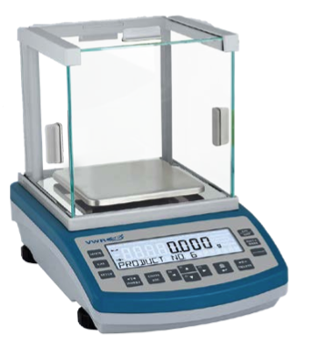
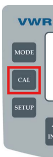
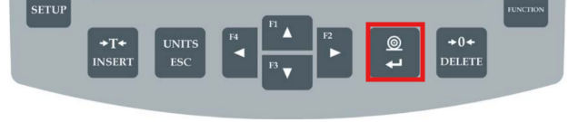

Lab Scale Calibration
=================

Materials
---------

* Calibration weights: Borrow both cases from Holtzapple lab.

Procedure - Large, glass-encased scale
---------

.. note::
    Manual is saved in Lab_Management/Equipment/Other/Sensitive scale model B2.pdf

1. Press CAL

2. Follow instructions on the screen, advancing through by pressing Enter

Procedure - Medium, next to glass-encased scale
---------

1. Enter the menu by pressing Enter, then F (while still holding down Enter). If you see UUGG, you've let go of Enter instead of holding it down. Press Esc, then try again.
2. Menu display P1.Cal. Press Tare button to enter the submenu for P1.
3. Displays Cal-E, which means you place on the pre-defined amount of weight, 2000g. Since we don't have a 2000g calibration weight, move down to Cal-U with the down arrow. Cal-U means user-calibration, which allows you to set the calibration weight.
4. Set value to 1000g with the various arrow buttons.
5. Press Enter.
6. Follow unloading and loading instructions, advancing through with Enter at each stage.
7. When complete, press ESC to exit back out of each menu layer and into normal operation.

Procedure - Small, Agar-Powder Scale (located by Gel-imager)
---------

1. Hold down the button which has the CAL icon in the corner.
2. Press Enter when it says CAL.
3. Clear, Load, and Unload following the instructions. Advance through with enter button.

Version history
---------------

================  ==========  ======================
Date              Author      Change
================  ==========  ======================
2026-11-12        TB          Initial version
================  ==========  ======================
