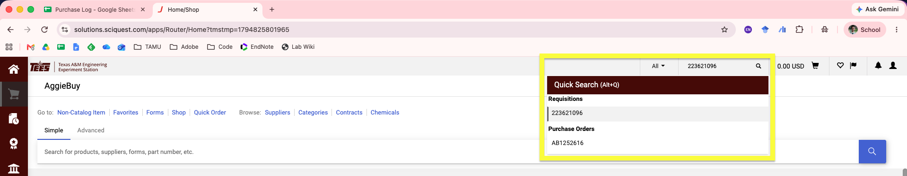

Ordering Guide
==============

.. note::
    This ordering guide is based on the current method provided by the Business Office.

1. Identifying Items for Purchase
-----------------
For standard lab consumables, refer to the `Hu Group Consumable Catalog <https://docs.google.com/spreadsheets/d/1CUrTDJ9xnsfZ-yfRGP6WdokUkwMn6jWg/edit?usp=drive_link&ouid=102279535347184920177&rtpof=true&sd=true>`_.

If anything you need is not in this sheet, search these companies first (log in with lab credentials for accurate pricing):

* **Fisher** for common consumables `fishersci.com <https://www.fishersci.com/us/en/home.html>`_
* **VWR** for common consumables `vwr.com <https://www.vwr.com/us/en/>`_
* **Sigma** for common consumables and chemicals `sigmaaldrich.com <https://www.sigmaaldrich.com/US/en>`_

2. Generating Quotes
-----------------

.. admonition:: Responsibility
    :class: important

    For companies that allow web-quote generation and for Amazon, creating the quote falls under each individual lab member's responsibility. Once contacting sales reps is necessary, the responsibility falls to the lab member in charge of ordering. In that case, send that lab member all necessary information (catalog numbers, quantities) so that he/she can request a quote. 

**Fisher Scientific, Sigma-Aldrich, NEB**: Log in with lab credentials. Create a shopping cart and generate a web quote. This typically produces a contract-priced, tax-exempt quote. If tax is applied to the quote, contact sales and request a tax-exempt quote.

**VWR**: Contact sales rep through lab email to request a quote.

**Amazon**: In a word document, assemble item names, hyperlinks, ASINs (Amazon Standard Identification Number, available if you scroll down and expand 'Item Details'), prices, quantities, and screenshots of each item. This serves as the quote for later submissions to business office.

**Twist (for gBlocks)**: Refer to `/Common/Wet Lab/G-Block Ordering Instructions.docx <https://docs.google.com/document/d/1fiCchI4QCV9sEl12QHM-Uz92NtXfRSHl/edit>`_.

**Plasmidsaurus (for plasmid sequencing)**: Refer to `/Common/Wet Lab/Plasmid Sequencing Ordering Protocol.docx <https://docs.google.com/document/d/18hqZ1pRqJsHudFvito9hqyTWR5H7WvVR/edit?usp=sharing&ouid=113113225958146260138&rtpof=true&sd=true>`_

**Sigma-Aldrich (for primers)**: Log into Sigma-Aldrich with lab credentials. Navigate to Products --> Molecular Biology and Functional Genomics --> Oligos, qPCR probes, and peptides --> Custom pre-designed DNA Oligos & qPCR Probes.

**Other Vendors** (e.g. BioRad, RPI, USP) : If no web-quote generation is available, contact the vendor's sales department to request a tax-exempt order quote.

3. Obtain Permission from Dr. Hu
--------------------------------

Obtain permission from Dr. Hu, drop the quote in the lab's Management Drive under Purchasing/0-TO BE ORDERED, and contact the lab member in charge of ordering.

4. PO Forms
---------
.. admonition:: Responsibility
    :class: important

    All remaining steps are handled by the lab member in charge of ordering.

PO (purchase order) forms contain vendor name, item number(s), item name(s), unit price(s), quantity(quantities), shipping method/cost, and account number.

The PO form is available on business office sharepoint, or in lab Google Drive in 'Purchasing' folder (which is pre-filled with some lab information).

5. Submitting Order Request
------------------------

Once the quote and PO form are ready, submit them through the business office order request form on the `CHEN Business Intranet <https://tamucs.sharepoint.com/sites/CHENBusinessIntranet>`_.

.. note::
    Access to the CHEN Business Intranet requires approval from the business office. Please contact them beforehand if you do not already have access.

After submission, the business office automatically generates a **submission ID**. Enter that order ID, along with all purchase information into the lab Purchase log.

The purchase is routed to the PI for approval via email. This process is relatively quick, since the email conveniently contains all necessary information for the PI. Once approved, you will be notified via email. Update the purchase log status. 

At this point, the purchase proceeds to the CHEN business office for actually placing the order. Typically, this is done through AggieBuy. When the order is placed, you will be notified via email with an **order number**. Enter that order number into the Purchase Log and update the purchase log status. 

This order number is internal to the A&M System—vendors will only recognize the **Purchase Order (PO) number**. If you need to contact a vendor regarding an order:

1. Log into AggieBuy via `SSO <https://sso.tamus.edu/>`_.
2. Search for the A&M order number in the search bar.
3. Locate the **Purchase Order** number listed underneath the Requisition/Order ID.

6. When Problems Arise
-----------------------

Issues are handled on a case-by-case basis, but here are some general guidelines to help:

1. If an item has not been received for an unusual amount of time:

- **Call the vendor** with the Purchase Order number from AggieBuy to track the order. The item may be out of stock.
- If the vendor says they **never received that item** in the order, then there was an issue with AggieBuy, business office, or PO/Quote documents. Double check original PO form for accurate catalog numbers. Then, email chen-business@tamu.edu to explain what's going on, communicate what the vendor said, and request assistance.

2. If an item arrives damaged:

- Contact chen-business@tamu.edu, responding to the initial order email ("Your ___ purchase request has been submitted!"). Request assistance in returning or refunding the item, as needed.

Version history
---------------

================  ==========  ======================
Date              Author      Change
================  ==========  ======================
2026-11-16        TB          Added specific instruction on when to request permission. Added more details on ordering follow up, including AggieBuy screenshot.
2026-11-06        TB          Add link to plasmid sequencing protocol, made by Will
2026-11-05        TB          Adding link to Hu Lab Consumables Sheet and other restructuring
2026-10-28        TB          Simplify, denote responsibility assignment, added info
2026-06-27        HN          Initial Version
================  ==========  ======================

